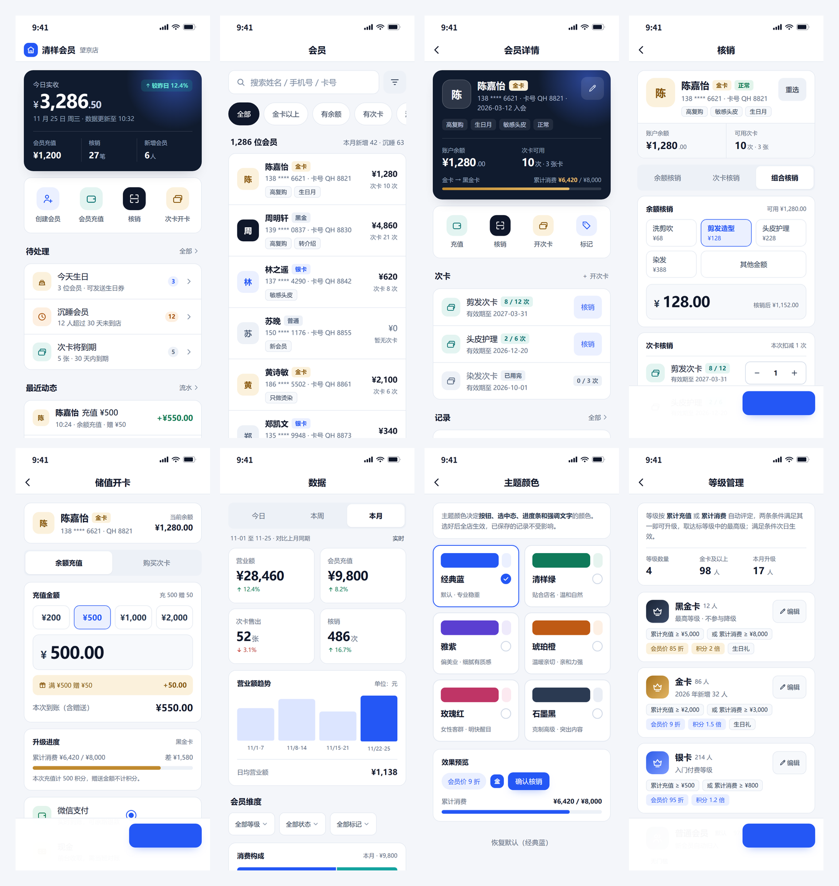
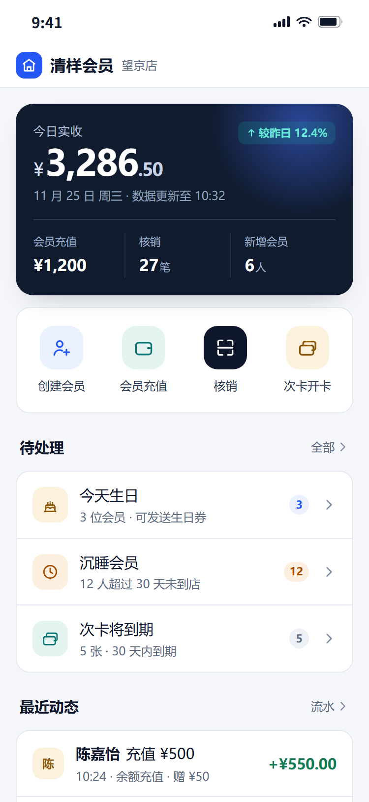
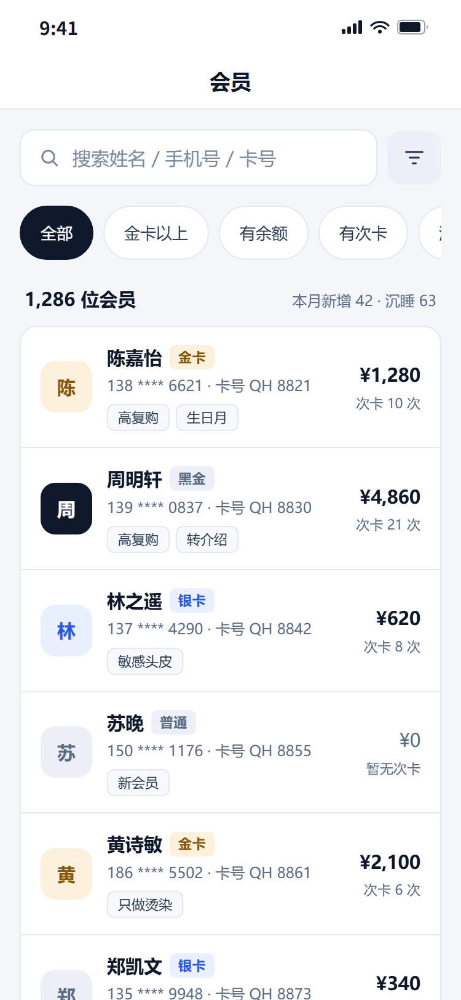
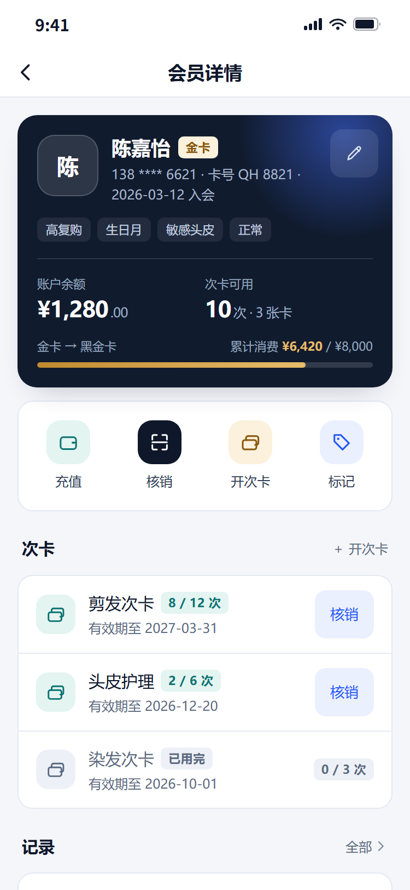
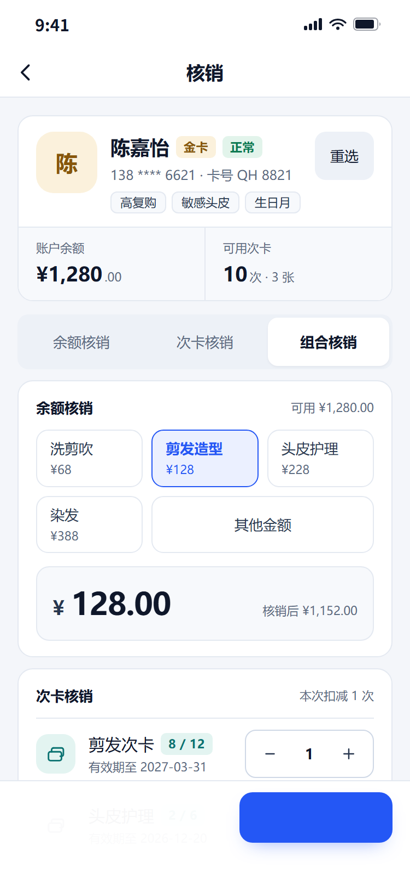
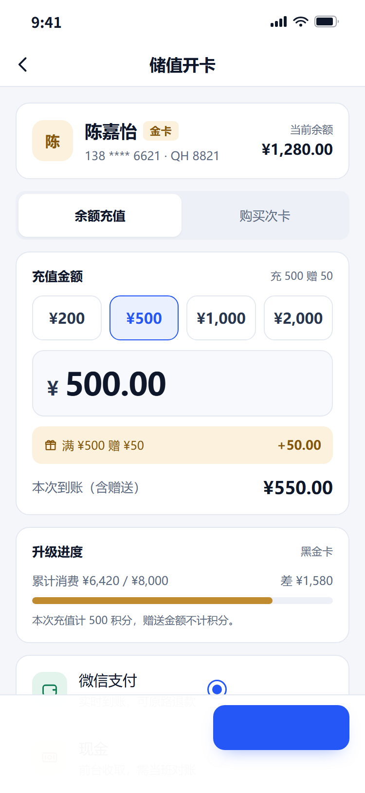
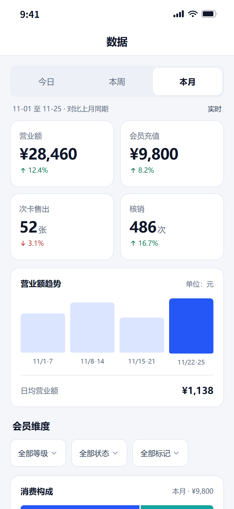
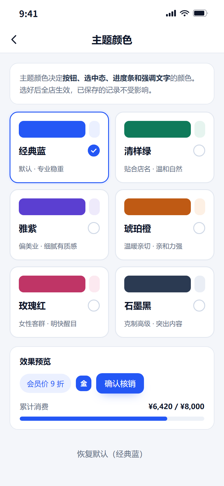
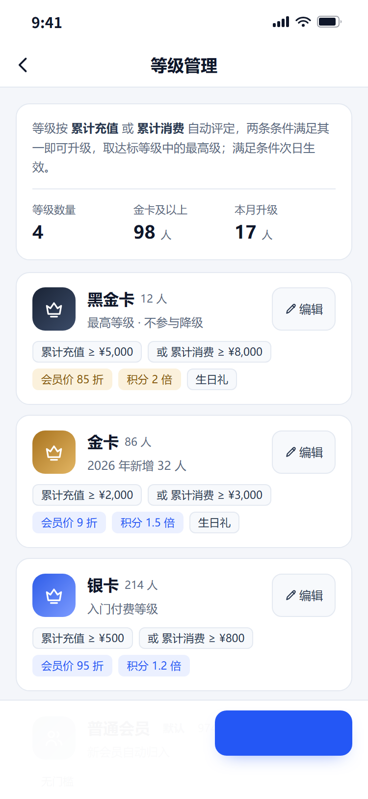

# 清样会员 · 门店会员管理小程序

一套**完整可运行**的微信小程序会员管理系统，覆盖「建档 → 储值 → 次卡 → 核销 → 积分 → 等级 → 记录 → 统计」全链路。
原生 WXML / WXSS，无第三方 UI 库依赖，开箱即用，可自由改名换色。



## 为什么会有这个项目

市面上开源的会员系统，要么是带一大堆插件的重型 SaaS，要么只画了几个首页就号称「完整」。
这个项目只做一件事：**把一家小店真正会用到的会员流程，从头到尾做完，并且做得好看。**

- 14 个页面，业务闭环完整，不是 demo 拼盘
- 一套设计变量（`tokens.css`）驱动全站，改一处全变
- 6 套主题色，店主自己就能换风格，不用改代码
- 零外部依赖，不引字体 CDN、不引组件库

## 预览

`design/` 目录是纯静态 HTML 原型，用浏览器直接打开 `design/home.html` 就能点：

- 顶部状态栏、导航、底部标签栏按真机比例还原（375×812）
- 页面之间是真链接，点得动
- 主题色可以实时切换（`design/theme.html`）

| 工作台 | 会员列表 | 会员详情 | 核销 |
|---|---|---|---|
|  |  |  |  |

| 储值开卡 | 数据看板 | 主题颜色 | 等级管理 |
|---|---|---|---|
|  |  |  |  |

## 功能清单

### 会员
- **建档**：手机号、姓名、性别、生日（可选）、初始余额（自动生成一笔充值记录）、开卡项目多选
- **编辑**：基本资料、标签、备注
- **标签与状态**：高复购、生日月、敏感头皮等自由标签；正常 / 沉睡 / 停用
- **多维度筛选**：等级、状态、标记、余额区间、次卡持有、最近到店

### 储值与次卡
- **余额充值**：固定档位＋自定义金额，赠送规则（充 500 赠 50），自动算出到账金额
- **次卡项目**：名称、次数、单价、有效期、适用门店
- **购买次卡**：会员详情里直接开卡，生成次卡记录

### 核销
- **三种查人方式**：手机后四位（模糊）、完整手机号、会员卡号
- **三种核销方式**：余额核销、次卡核销、组合核销（同时扣余额和次数）
- **服务项快选**：洗吹 / 剪发造型 / 染发 / 头皮护理，也支持「其他金额」自由输入
- 核销后实时显示扣减结果与余额变化

### 记录
- 消费核销、余额充值、次卡购买、次卡核销，四类流水
- 每条记录带时间、操作人、金额、余额快照

### 数据
- 今日 / 本周 / 本月三档
- 营业额、会员充值、次卡售出、核销次数四个核心指标，带环比
- 营业额趋势柱状图、消费构成占比
- 会员维度筛选（等级 / 状态 / 标记）

### 管理
- **等级管理**：等级名称、门槛（累计充值 / 累计消费）、会员价折扣、积分倍率、生日礼
- **积分设置**：消费积分、充值积分、签到积分、积分抵扣比例
- **次卡项目**：增删改、上下架
- **主题颜色**：6 套配色，选中即全站生效

## 目录结构

```
qingyang-member/
├── design/                  # 静态 HTML 原型（浏览器直接打开）
│   ├── home.html            # 工作台
│   ├── members.html         # 会员列表
│   ├── member-detail.html   # 会员详情
│   ├── member-new.html      # 新增会员
│   ├── member-edit.html     # 编辑会员
│   ├── verify.html          # 核销
│   ├── recharge.html        # 储值开卡
│   ├── levels.html          # 等级管理
│   ├── points.html          # 积分设置
│   ├── cards.html           # 次卡项目
│   ├── records.html         # 记录
│   ├── stats.html           # 数据
│   ├── settings.html        # 管理
│   ├── theme.html           # 主题颜色
│   ├── tokens.css           # 设计变量（颜色 / 字号 / 圆角 / 阴影）
│   ├── app.css              # 公共组件样式
│   ├── icons.svg            # 图标雪碧图（统一 24 栅格线性图标）
│   └── theme.js             # 主题切换（仅原型用）
├── miniapp/                 # 微信原生小程序
│   ├── app.js               # 启动：灌种子数据、探测云环境、首次同步
│   ├── app.json
│   ├── app.wxss             # rpx 全量样式 + 图标 + 主题类
│   ├── project.config.json
│   ├── sitemap.json
│   ├── utils/               # 数据层（核心）
│   │   ├── store.js         # 本地存储：读写、软删除、发件箱、冲突合并
│   │   ├── sync.js          # 云同步：推送、拉取、失败降级
│   │   ├── biz.js           # 业务逻辑：建档、充值、核销、统计
│   │   ├── seed.js          # 首启示例数据
│   │   └── __smoke.js       # 自测脚本（node 直接跑，55 项）
│   ├── cloudfunctions/
│   │   └── sync/            # 云函数：push / pull
│   ├── custom-tab-bar/      # 自定义底部标签栏
│   └── pages/               # 14 个页面，每个 4 个文件
│       ├── index/           # 工作台
│       ├── members/
│       ├── member-detail/
│       ├── member-new/
│       ├── member-edit/
│       ├── verify/
│       ├── recharge/
│       ├── levels/
│       ├── points/
│       ├── cards/
│       ├── records/
│       ├── stats/
│       ├── settings/
│       └── theme/
└── docs/
    ├── cover.png
    └── screenshots/         # 14 屏截图
```

## 快速开始

### 跑原型（不需要任何环境）

```
用浏览器打开 design/home.html
```

### 跑小程序

1. 下载并安装[微信开发者工具](https://developers.weixin.qq.com/miniprogram/dev/devtools/download.html)
2. 「导入项目」→ 目录选 `miniapp/`
3. AppID 填你自己的（或选「测试号」）
4. 编译，即可在模拟器里看到全部 14 个页面

> 项目当前用 `touristappid`，只能本地预览。要真机调试或发布，换成自己的 AppID。

## 换主题

所有颜色来自 `design/tokens.css` 的 CSS 变量。换主题只要改一个属性：

```html
<!-- 可选：blue（默认）/ green / violet / orange / rose / graphite -->
<html lang="zh-CN" data-theme="green">
```

小程序端同理，在 `app.wxss` 里已经有 `.theme-green`、`.theme-violet` 等类，页面根节点带 `theme-{{theme}}` 即可。

想改品牌主色，只改 `tokens.css` 里这几行：

```css
--primary:#2457F5;        /* 主色 */
--primary-deep:#1A44CC;   /* 深一档，用于按下态 */
--primary-soft:#EBF0FF;   /* 浅色底，用于选中背景 */
--primary-soft-2:#DCE5FF;
```

## 改成你自己的店

1. **品牌名**：全局搜 `清样` 替换
2. **门店名**：搜 `望京店`
3. **主色**：改 `tokens.css` 的 `--primary` 系列（小程序改 `app.wxss`）
4. **服务项目**：`verify.html` / `verify.wxml` 里的「洗吹 / 剪发造型 / 染发 / 头皮护理」换成你的
5. **等级名称**：`levels.html` / `levels.wxml` 里的「黑金 / 金卡 / 银卡」

## 现在有什么、没有什么

诚实说明，避免误解。

**已经有**
- 14 个页面的完整 UI，原生小程序可直接编译
- 全部交互状态：默认 / 筛选展开 / 编辑态 / 核销多种方式
- **本地持久化存储**：数据存在本机，关掉小程序再打开还在
- **云端自动同步**：配了云环境就双向同步；没配或断网时自动降级为纯本地，功能不掉
- **真实的业务运算**：建档、编辑、充值、购卡、核销、统计都是真算的，不是写死的数字
- 设计变量体系与 6 套主题
- 示例数据（陈嘉怡、周明轩等为虚构，手机号已脱敏）

**还没有**
- ❌ **云端已部署**。云函数代码写好了（`cloudfunctions/sync`），但需要你自己开环境、建集合、上传部署
- ❌ **登录与权限**。当前不区分账号，同一台设备数据共享
- ❌ **支付**。充值只记账，不走微信支付，需要商户号
- ❌ **严格并发控制**。多台设备同时改同一个会员的余额会丢更新，见 [docs/SYNC.md](docs/SYNC.md) 第四节

也就是说：**这是一个能真记账、数据不会丢的小程序；云端备份需要按文档配一次，且不适合多人同时改同一个会员。**

## 路线图

- [x] 14 屏界面设计与静态原型
- [x] 微信原生小程序代码
- [x] 设计变量与主题体系
- [x] 本地持久化存储（`store.js`）
- [x] 云端同步与降级（`sync.js` + `cloudfunctions/sync`）
- [x] 业务逻辑层（`biz.js`：建档、充值、核销、统计）
- [x] 14 个页面全部接真实数据
- [x] 数据层自测脚本（55 项）
- [ ] 云开发环境实际部署（需你自己开环境）
- [ ] 微信登录 + 员工权限
- [ ] 严格并发控制（云函数事务）
- [ ] 数据导出（Excel / CSV）

## 文档

| 文档 | 内容 |
|---|---|
| [docs/SYNC.md](docs/SYNC.md) | **本地存储与云端同步**：三层结构、存储键设计、发件箱、LWW 冲突解决、降级机制、已知限制 |
| [docs/CLOUD.md](docs/CLOUD.md) | **云开发接入步骤**：开环境、建 7 个集合、建索引、配权限、写云函数、金额操作的三条铁律、统计聚合、7 个常见坑 |
| [docs/ROADMAP.md](docs/ROADMAP.md) | 功能规划与范围边界 |
| [CONTRIBUTING.md](CONTRIBUTING.md) | 开发约定 |

## 技术说明

- **原生框架**：WXML + WXSS + JS，不依赖 Taro / uni-app / 任何 UI 库
- **数据架构**：本地优先（local-first）。页面只读本地，云数据库负责备份与多端同步，断网不影响功能
- **单位**：小程序端统一用 `rpx`（1px ≈ 2rpx），原型端用 `px` + 设计变量
- **金额**：全程以「分」为单位存整数，展示时才除 100，避免浮点误差
- **图标**：全部是 SVG `<symbol>`，通过 `mask-image` 着色，改 `currentColor` 就跟着变色，不额外引图标字体
- **标签栏**：`custom-tab-bar` 自定义，5 个 tab：工作台 / 会员 / 记录 / 数据 / 管理
- **无外链**：字体用系统字体栈（PingFang SC / HarmonyOS Sans / MiSans / 微软雅黑），不连 CDN，离线也能正常显示

## 设计说明

- 风格：专业科技，冷灰蓝底 + 单一主色，信息密度高但层级清楚
- 中文排版：正文 15px，行高 1.55，中英文之间留空格
- 对比度：正文对背景 ≥ 4.5:1
- 一屏只有一个焦点，主操作按钮只有一个
- 深色卡片（今日实收）作为视觉锚点，其余留白

## 许可

[MIT](LICENSE) —— 可商用、可修改、可再发布，保留版权声明即可。

## 贡献

Issue / PR 都欢迎。动手前先看 [CONTRIBUTING.md](CONTRIBUTING.md)。
如果是较大的改动，建议先开 Issue 聊一下方向，避免白做。

## 致谢

界面与代码由本项目维护者原创完成，未使用任何第三方 UI 组件库或图标字体。

## 免责

示例数据（人名、手机号、金额、门店名）全部为虚构，手机号已做脱敏处理，与任何真实个人或商户无关。
